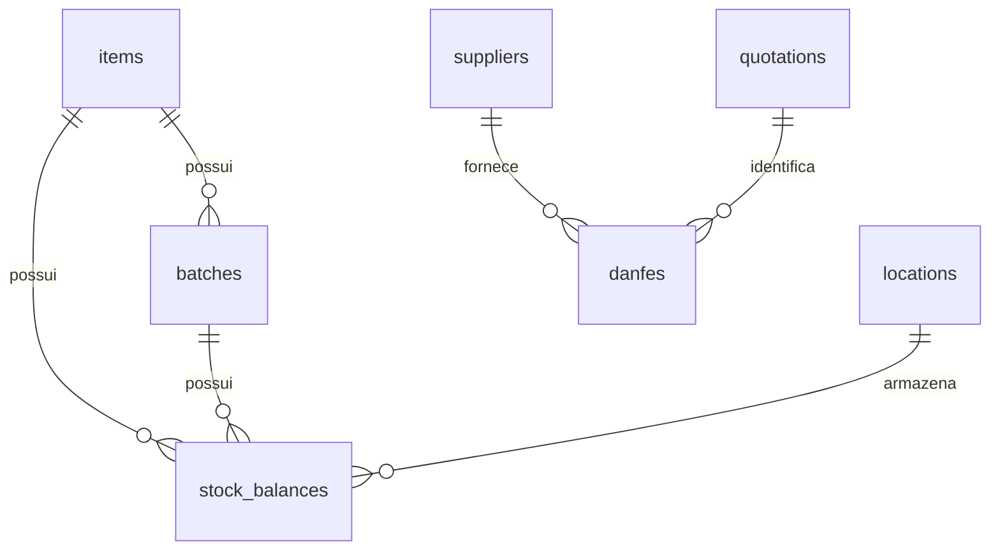

# Modelo de dados atual

O modelo permanece em `Data/AppDbContext.cs`, com PostgreSQL e ASP.NET Core Identity.

O diagrama completo foi extraído diretamente dos catálogos do banco `repypharm` em 22/11/2026: **15 tabelas, 86 colunas, 12 chaves estrangeiras e 32 índices**, incluindo autenticação e `__EFMigrationsHistory`.

- [Imagem PNG em alta resolução](../wwwroot/img/diagrama-banco-dados.png).
- [Imagem SVG para ampliar sem perder qualidade](../wwwroot/img/diagrama-banco-dados.svg).
- [Fonte editável em Graphviz DOT](diagrama-banco-dados.dot).

As imagens mostram campos, tipos, nulabilidade, valores padrão, identidades, chaves primárias simples/compostas, chaves estrangeiras, cardinalidades, índices únicos/compostos/parciais e regras de exclusão/atualização. Foram consultados somente metadados, sem incluir registros das tabelas.

| Tabela | Entidade | Função |
| --- | --- | --- |
| `items` | `Item` | Código, nome, unidade, classificação, estado ativo e datas do item. |
| `batches` | `Batch` | Lote e validade associados ao item. |
| `locations` | `Location` | Código, nome e estado ativo do local de armazenamento. |
| `stock_balances` | `StockBalance` | Quantidade por combinação item, lote e local; índice único nessa combinação. |
| `danfes` | `Danfe` | Registro de nota fiscal, recebimento, vencimento, fornecedor e cotação. |
| `suppliers` | `Supplier` | Fornecedores necessários ao cadastro de DANFEs. |
| `quotations` | `Quotation` | Identificação da cotação exigida pela DANFE. |
| `AspNet*` | Identity e `ApplicationUser` | Usuários, credenciais, papéis, permissões, perfil e solicitações de senha. |

`StockBalance` permanece indispensável ao registro do estoque. `Item`, `Batch` e `Location` não armazenam isoladamente as quantidades por lote/local. `ItemType` continua como enum persistido no item, sem alteração dos seus valores.

A classificação de itens, a precisão de quantidades, os índices e os relacionamentos das entidades mantidas foram preservados. A importação PDF continua sincronizando o espelho atual; a importação JSON continua criando/atualizando os registros presentes no arquivo.

## Remoção da lógica anterior

Foram retiradas do modelo as entidades `Consumption`, `DailyConsumption`, `ItemConsumptionAverage`, `ReplenishmentRule`, `ReportImport`, `ReportItem` e `QuotationXItem`, além do enum `ReportImportStatus` e das navegações correspondentes.

A migration `20261122150535_RemoveLegacyConsumptionAndReplenishment` elimina exclusivamente:

- `consumptions`;
- `daily_consumptions`;
- `item_consumption_averages`;
- `replenishment_rules`;
- `report_items`;
- `report_imports`;
- `quotation_x_items`.

O histórico anterior de migrations foi mantido para bancos já existentes. O snapshot reflete o modelo atual. A migration nova foi aplicada, por solicitação do usuário, em 22/11/2026 ao banco `repypharm` em `127.0.0.1:5432`. As sete tabelas acima e seus dados foram excluídos. A conferência posterior confirmou contagens inalteradas nas tabelas preservadas e ausência de migrations pendentes. O rollback recria as estruturas excluídas, sem recuperar seus registros.

A aplicação continua sem executar `Database.Migrate` automaticamente. Esta atualização foi aplicada manualmente pelo comando `dotnet ef database update 20261122150535_RemoveLegacyConsumptionAndReplenishment --context AppDbContext --no-build`.
